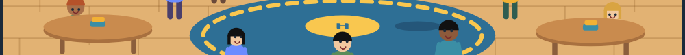

# School Drone 學校無人機

**▶ Play / 開始玩: https://ultralabed.github.io/School-Drone/**

## English

School Drone is a free web game for kids. It helps kids learn how to fly drones.

A robot teacher lives inside the drone. It talks to the kids and explains what
the drone is doing. The drone has 3 batteries, so every kid gets a turn.

### What you can do

- Press **Up, Down, Left, Right, Hover** to fly the drone.
- Press **8 Bee dance** to fly a figure 8, like a bee.
- Press **Land** to come back to the yellow pad.
- Tap anywhere in the library to tell the drone where to go.
- Pick a drone: 4 propellers, helicopter, jet, or 6 propellers.
- Press **中文 / English** to change the language.

### What kids learn

- **Up and down:** faster propellers push more air down, and the drone goes up.
- **Left and right:** the drone leans a little, and then it slides that way.
- **Hover:** the drone can stay still in the air.
- **Batteries:** a good pilot lands before the battery is empty. With 3 batteries, kids take turns.
- **Safety:** keep the drone away from people, walls and bookshelves.
- **Flying machines:** 4 propellers, 6 propellers, a helicopter and a jet all fly in different ways.
- **Nature:** bees dance in a figure 8 to show friends where the flowers are.

### How to run it on your computer

Open `index.html` in a web browser. There is nothing to install.

## 中文

「學校無人機」是一個給小朋友的免費網頁遊戲,幫助小朋友學習怎麼飛無人機。

無人機裡住著一位機器人老師,會說話告訴大家無人機正在做什麼。
無人機有 3 顆電池,所以每個小朋友都可以輪流飛。

### 可以做什麼

- 按 **上、下、左、右、懸停** 來飛無人機。
- 按 **8 蜜蜂舞**,無人機會像蜜蜂一樣飛 8 字。
- 按 **降落**,無人機會回到黃色降落墊。
- 點圖書館的任何地方,告訴無人機要飛去哪裡。
- 選一台無人機:4 個螺旋槳、直升機、噴射機、6 個螺旋槳。
- 按 **中文 / English** 換語言。

### 小朋友可以學到什麼

- **上和下:** 螺旋槳轉得越快,往下推的空氣越多,無人機就會往上飛。
- **左和右:** 無人機的身體斜一點點,就會往那一邊滑過去。
- **懸停:** 無人機可以停在空中不動。
- **電池:** 好的飛行員會在沒電以前降落。有 3 顆電池,大家可以輪流飛。
- **安全:** 無人機要離人、牆壁和書櫃遠一點。
- **飛行器:** 4 個螺旋槳、6 個螺旋槳、直升機和噴射機,飛的方法都不一樣。
- **大自然:** 蜜蜂會跳 8 字舞,告訴朋友花在哪裡。

## License and credit / 授權與作者

Made by / 作者:[Edward Shih](https://www.linkedin.com/in/edward-shih-43942786)

MIT license. You may use, copy and change this project. Please keep the
copyright line from the [LICENSE](LICENSE) file so people can find the author.

MIT 授權。你可以使用、複製和修改這個作品,請保留 [LICENSE](LICENSE) 裡的版權那一行,讓大家找得到作者。
