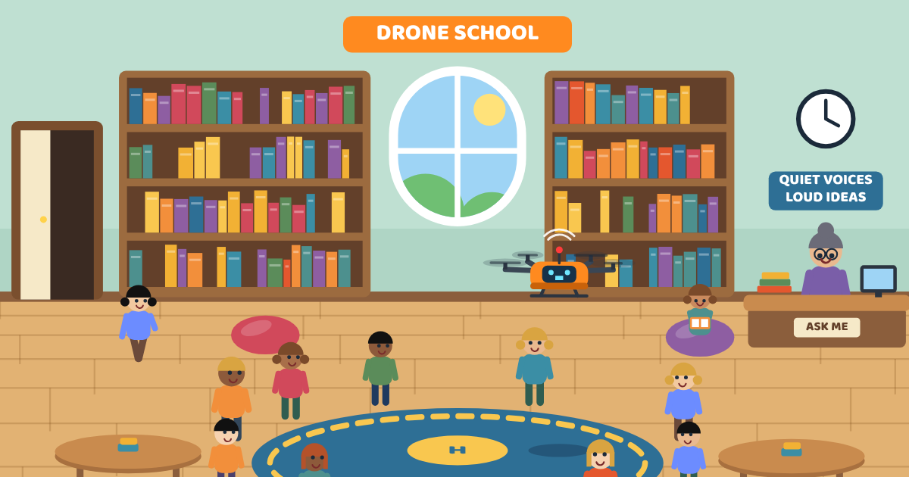

# 學校無人機 School Drone

[English](README.md) | **中文**

**▶ 開始玩:https://ultralabed.github.io/School-Drone/**

「學校無人機」是一個給小朋友的免費網頁遊戲,幫助小朋友學習怎麼飛無人機。

無人機裡住著一位機器人老師,會說話告訴大家無人機正在做什麼。
無人機有 3 顆電池,所以每個小朋友都可以輪流飛。

## 可以做什麼

- 按 **上、下、左、右、懸停** 來飛無人機。
- 按 **8 蜜蜂舞**,無人機會像蜜蜂一樣飛 8 字。
- 按 **降落**,無人機會回到黃色降落墊。
- 點圖書館的任何地方,告訴無人機要飛去哪裡。
- 選一台無人機:4 個螺旋槳、直升機、噴射機、6 個螺旋槳。
- 按 **中文 / English** 換語言。

## 小朋友可以學到什麼

- **上和下:** 螺旋槳轉得越快,往下推的空氣越多,無人機就會往上飛。
- **左和右:** 無人機的身體斜一點點,就會往那一邊滑過去。
- **懸停:** 無人機可以停在空中不動。
- **電池:** 好的飛行員會在沒電以前降落。有 3 顆電池,大家可以輪流飛。
- **安全:** 無人機要離人、牆壁和書櫃遠一點。
- **飛行器:** 4 個螺旋槳、6 個螺旋槳、直升機和噴射機,飛的方法都不一樣。
- **大自然:** 蜜蜂會跳 8 字舞,告訴朋友花在哪裡。

## 授權與作者

點子來自 Aaron Shih,由他的爸爸 [Edward Shih](https://www.linkedin.com/in/edward-shih-43942786) 製作。

MIT 授權。你可以使用、複製和修改這個作品,請保留 [LICENSE](LICENSE) 裡的版權那一行,讓大家找得到作者。
